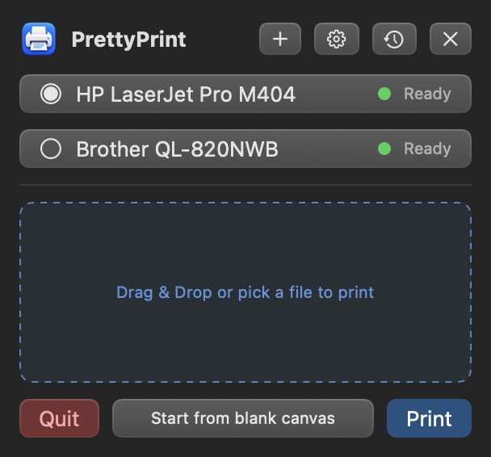

# PrettyPrint

A menu bar app for printing on your Mac. Drop in files, set copies, lay out a page, and print to any printer macOS knows about.



## Install

Download [PrettyPrint.dmg](https://github.com/landmann/prettyprint/releases/latest/download/PrettyPrint.dmg) from the latest release. It runs on macOS 14 or later, on Apple silicon and Intel.

1. Open the DMG and drag PrettyPrint into Applications.
2. Open PrettyPrint. The app isn't notarized yet, so macOS says it can't verify the developer. Click **Done**.
3. In **System Settings › Privacy & Security**, click **Open Anyway** next to PrettyPrint, then confirm with your password.

PrettyPrint lives in the menu bar under the printer icon and opens at login. Turn that off in System Settings › General › Login Items. On first launch it offers to open the Full Disk Access setting so it can print files from any folder without asking again. That's optional.

## Features

- **Print queue.** Drag files onto the menu bar icon or pick them, set copies for each, and print the whole queue.
- **Any printer.** Lists every printer set up on your Mac, checks that each one is actually reachable, picks one that's ready, and offers two-sided printing where the printer supports it.
- **Page layout.** Place images, PDF pages, and text on one sheet with rulers, gridlines, snapping, and rotation. The page matches the printer's default paper size.
- **Add printers.** Finds printers on your network and over USB. AirPrint and IPP Everywhere printers are added without a driver; printers with an installed driver use it. Anything else is one click away in macOS Printers & Scanners, which can download Apple-hosted drivers.
- **Driver finder.** For printers that need a manufacturer driver, see below.
- **Print history.** The last five printed files, one click from the queue.
- **Keyboard shortcuts.** Every action has one, and you can change any of them in Settings.

## Driver finder

Some printers, label printers especially, need a driver from their manufacturer. PrettyPrint can find it with an AI model you already pay for. Set it up in **Settings › Driver finder** with either:

- an Anthropic or OpenAI API key, stored in your macOS Keychain, or
- the [Claude Code](https://claude.com/claude-code) CLI, if it's installed and signed in. No key is needed.

When you click **Find driver**, PrettyPrint sends the printer's name, model, and IEEE 1284 device ID, your macOS version, and your Mac's chip type. The model searches the manufacturer's site and returns the driver's download page and, when it finds one, a direct link to the package.

Before anything is installed:

- The download must use HTTPS and stay under 2 GB, and a ZIP must expand to under 4 GB.
- The installer package or app must pass Gatekeeper as notarized Developer ID software (`spctl --assess`). PrettyPrint checks again right before opening it.
- PrettyPrint shows who signed it, and opens it only when you click **Open installer**. You finish in the manufacturer's installer, and PrettyPrint adds the printer when it quits.
- When the model finds only a download page, PrettyPrint opens it in your browser. Install the driver, then click **Add**.

Claude Code runs in safe mode, which turns off your hooks, plugins, MCP servers, and `CLAUDE.md`, with only its web search and web fetch tools, in an empty temporary folder.

## Privacy

PrettyPrint has no analytics and no account. It goes online only when you use the driver finder or download a driver.

## Build from source

You need the Xcode command line tools and macOS 14 or later.

```sh
bash build.sh     # builds build/PrettyPrint.app
bash test.sh      # runs the tests
bash release.sh   # builds a universal, ad-hoc signed build/PrettyPrint.dmg
```

There are no dependencies and no Xcode project. The scripts compile every `.swift` file under `Sources` with `swiftc`. [AGENTS.md](AGENTS.md) maps the folders.

## License

[Apache 2.0](LICENSE)
